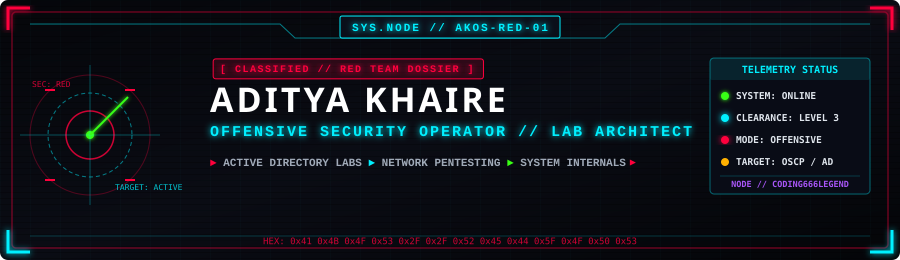
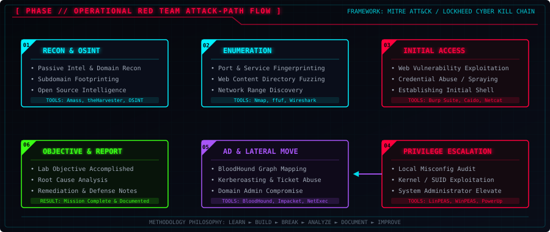
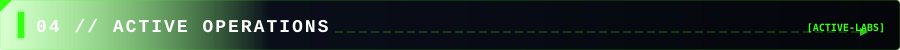
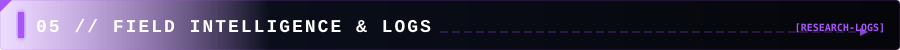
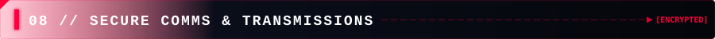

<div align="center">

<!-- HERO BANNER -->
<a href="https://github.com/Coding666Legend">
  
</a>

<br/>

<!-- SYSTEM STATUS INDICATORS -->
<p align="center">
  <code><b>[ CLASSIFICATION: RED TEAM OPERATOR ]</b></code> &nbsp;
  <code><b>[ STATUS: SYSTEM ONLINE ]</b></code> &nbsp;
  <code><b>[ CLEARANCE: LEVEL 3 ]</b></code> &nbsp;
  <code><b>[ MISSION: OSCP / AD ]</b></code>
</p>

<!-- TACTICAL NAVIGATION BAR -->
<p align="center">
  <a href="#01--operator-dossier"><code>[ 01-DOSSIER ]</code></a> &bull;
  <a href="#02--attack-methodology"><code>[ 02-METHODOLOGY ]</code></a> &bull;
  <a href="#03--tactical-arsenal"><code>[ 03-ARSENAL ]</code></a> &bull;
  <a href="#04--active-operations"><code>[ 04-OPERATIONS ]</code></a> &bull;
  <a href="#05--field-intelligence--logs"><code>[ 05-INTELLIGENCE ]</code></a><br/>
  <a href="#06--certification-trajectory"><code>[ 06-CERTS ]</code></a> &bull;
  <a href="#07--system-telemetry--metrics"><code>[ 07-TELEMETRY ]</code></a> &bull;
  <a href="#08--secure-comms--transmissions"><code>[ 08-COMMS ]</code></a>
</p>

</div>

---

<br/>

<!-- SECTION 01: OPERATOR DOSSIER -->


<br/>

<table>
  <tr>
    <td width="65%" valign="top">
      <h3><code>[ OPERATOR IDENTITY &amp; CORE FOCUS ]</code></h3>
      <p>
        Welcome to <b>AKOS (Aditya Khaire Security Operations)</b> node. I am an <b>Offensive Security Operator &amp; Lab Architect</b> focused on low-level system internals, Active Directory attack ranges, and offensive security tradecraft.
      </p>
      <p>
        I specialize in building hands-on cybersecurity attack ranges (Active Directory, vulnerable web applications, Linux environments) to dissect how modern enterprise networks are breached and defended.
      </p>
      <br/>
      <h4><code>[ CORE OPERATIONAL PHILOSOPHY ]</code></h4>
      <pre><code>LEARN ► BUILD ► BREAK ► ANALYZE ► DOCUMENT ► IMPROVE</code></pre>
      <p>
        <i>"I prefer breaking systems in controlled lab environments to understand how they actually function at the kernel and network layer."</i>
      </p>
    </td>
    <td width="35%" valign="top">
      <h3><code>[ CORE TELEMETRY ]</code></h3>
      <ul>
        <li><b>HANDLE:</b> <code>Coding666Legend</code></li>
        <li><b>NAME:</b> Aditya Khaire</li>
        <li><b>FOCUS:</b> Red Team &amp; AD Labs</li>
        <li><b>INTERESTS:</b> Assembly, Linux Internals</li>
        <li><b>ENVIRONMENT:</b> Linux / Docker / Windows Server</li>
        <li><b>STATUS:</b> Active Research</li>
      </ul>
      <hr/>
      <p align="center">
        <sub><b>NODE STATUS:</b> <code>ONLINE // 0x414B</code></sub>
      </p>
    </td>
  </tr>
</table>

<br/>

---

<br/>

<!-- SECTION 02: ATTACK METHODOLOGY -->


<br/>

<p align="center">
  
</p>

<details>
  <summary><b>[ CLICK TO EXPAND // TACTICAL TRADECRAFT BREAKDOWN ]</b></summary>
  <br/>
  <table>
    <tr>
      <th>Phase</th>
      <th>Tactical Objective</th>
      <th>Primary Methodology &amp; Vectors</th>
    </tr>
    <tr>
      <td><b>01 // RECON</b></td>
      <td>Passive &amp; Active Intelligence Gathering</td>
      <td>OSINT footprinting, ASN mapping, subdomain enumeration, public code leak checks.</td>
    </tr>
    <tr>
      <td><b>02 // ENUMERATION</b></td>
      <td>Attack Surface Mapping</td>
      <td>Nmap port scanning, web application directory/parameter fuzzing, service version fingerprinting.</td>
    </tr>
    <tr>
      <td><b>03 // INITIAL ACCESS</b></td>
      <td>Establishing Initial Foothold</td>
      <td>Exploiting web misconfigurations, authentication bypass, initial shell payload execution.</td>
    </tr>
    <tr>
      <td><b>04 // PRIVESC</b></td>
      <td>Local System Escalation</td>
      <td>Linux SUID/Capability abuse, Windows service misconfigurations, kernel exploit research.</td>
    </tr>
    <tr>
      <td><b>05 // AD &amp; LATERAL</b></td>
      <td>Domain Compromise</td>
      <td>BloodHound graph analysis, Kerberoasting, AS-REP roasting, Pass-the-Hash, Domain Admin pathing.</td>
    </tr>
    <tr>
      <td><b>06 // OBJECTIVES</b></td>
      <td>Post-Exploitation &amp; Analysis</td>
      <td>Lab objective completion, root cause investigation, defensive mitigation documentation.</td>
    </tr>
  </table>
</details>

<br/>

---

<br/>

<!-- SECTION 03: TACTICAL ARSENAL -->


<br/>

<p>
  Tools and technologies utilized within controlled lab ranges and security research operations:
</p>

### <code>[ 01 // RECONNAISSANCE &amp; OSINT ]</code>
<p>
  
  
  
  
  
</p>

### <code>[ 02 // WEB APPLICATION SECURITY ]</code>
<p>
  
  
  
  
  
</p>

### 3. <code>[ 03 // ACTIVE DIRECTORY &amp; PRIVILEGE ESCALATION ]</code>
<p>
  
  
  
  
  
  
</p>

### 4. <code>[ 04 // DEVELOPMENT &amp; INFRASTRUCTURE ]</code>
<p>
  
  
  
  
  
  
  
  
  
</p>

<br/>

---

<br/>

<!-- SECTION 04: ACTIVE OPERATIONS -->


<br/>

<p>Current security research projects and lab environment deployments:</p>

<table>
  <tr>
    <td width="50%" valign="top">
      <h4><code>OPERATION 001 // AD-ATTACK-RANGE</code></h4>
      <p><b>OBJECTIVE:</b> Multi-domain Active Directory vulnerability range.</p>
      <p><b>TECH STACK:</b> Windows Server, PowerShell, BloodHound, Impacket.</p>
      <p><b>DESCRIPTION:</b> Custom Active Directory attack range configured with vulnerable delegation, Kerberos tickets, and unconstrained delegation paths for hands-on exploitation practice.</p>
      <p><a href="https://github.com/Coding666Legend"><code>[ VIEW MISSION REPOSITORY ]</code></a></p>
    </td>
    <td width="50%" valign="top">
      <h4><code>OPERATION 002 // INFRA-PENTEST-RANGE</code></h4>
      <p><b>OBJECTIVE:</b> Infrastructure penetration testing, exploitation, and post-exploitation within a controlled virtualized lab environment.</p>
      <p><b>TECH STACK:</b> Kali Linux, Metasploitable 2, QEMU/KVM, Libvirt.</p>
      <p><b>DESCRIPTION:</b> Conducted reconnaissance, vulnerability assessment, exploitation, privilege escalation, and post-exploitation against intentionally vulnerable systems in an isolated lab. Leveraged Kali Linux and virtualized infrastructure to simulate infrastructure penetration testing workflows.</p>
      <p><a href="https://github.com/Coding666Legend/appsec-and-network-pentesting-lab"><code>[ VIEW MISSION REPOSITORY ]</code></a></p>
    </td>
  </tr>
</table>

<br/>

---

<br/>

<!-- SECTION 05: FIELD INTELLIGENCE & LOGS -->


<br/>

<p>Documentation, lab writeups, and technical research logs:</p>

<details>
  <summary><b>[ INTEL LOG 001 ] Active Directory Kerberoasting &amp; Ticket Misconfigurations</b></summary>
  <br/>
  <p><b>SUMMARY:</b> Deep dive into service principal name (SPN) enumeration, requesting TGS tickets, offline hash cracking with Hashcat, and mitigation via Managed Service Accounts (gMSA).</p>
  <p><b>KEY TAKEAWAYS:</b> Weak service account passwords remain a high-impact vector for fast privilege escalation to Domain Admin once initial foothold is established.</p>
</details>

<details>
  <summary><b>[ INTEL LOG 002 ] Web Application Fuzzing Tradecraft &amp; Parameter Discovery</b></summary>
  <br/>
  <p><b>SUMMARY:</b> Optimizing <code>ffuf</code> and Burp Suite workflows for hidden endpoint discovery, custom wordlist filtering by HTTP response length, and parameter pollution attacks.</p>
  <p><b>KEY TAKEAWAYS:</b> Filtering standard response codes (`-fc 404,403`) combined with size-based filtering yields critical unlinked API endpoints.</p>
</details>

<details>
  <summary><b>[ INTEL LOG 003 ] Linux Privilege Escalation via SUID &amp; Capability Abuse</b></summary>
  <br/>
  <p><b>SUMMARY:</b> Systematic audit of custom SUID binaries, GTFOBins exploitation paths, and Linux capabilities (<code>cap_setuid</code>, <code>cap_dac_read_search</code>).</p>
  <p><b>KEY TAKEAWAYS:</b> Unnecessary execution capabilities set on system binaries frequently bypass traditional sudo restrictions.</p>
</details>

<details>
  <summary><b>[ INTEL LOG 004 ] Docker Socket Misconfiguration &amp; Host Escape Vectors</b></summary>
  <br/>
  <p><b>SUMMARY:</b> Analyzing security implications of exposing <code>/var/run/docker.sock</code> inside container environments and execution of root-equivalent host mounts.</p>
  <p><b>KEY TAKEAWAYS:</b> Exposing the Docker socket inside an unprivileged container grants defacto root access to the underlying host OS.</p>
</details>

<br/>

---

<br/>

<!-- SECTION 06: CERTIFICATION TRAJECTORY -->


<br/>

<p>Targeted security certifications and hands-on skill verification roadmap:</p>

```text
========================================================================================
[ STATUS ]   [ IDENTIFIER ]   [ CERTIFICATION / SKILL DOMAIN ]           [ TRACK ]
========================================================================================
  [✓]        NET-SEC-01       Networking & TCP/IP Tradecraft             Completed
  [✓]        LNX-ADM-02       Linux System Administration & Shell        Completed
  [✓]        WIN-SYS-03       Windows Server & Active Directory Basics   Completed
  [✓]        THM-LABS-04       TryHackMe / HTB Offensive Security Labs    Completed
  [◉]        AD-SEC-05        Active Directory Attack & Defense Vectors  In Progress
  [◉]        WEB-SEC-06       Web Application Pentesting & Fuzzing       In Progress
  [ ]        PNPT-CERT        Practical Network Penetration Tester       Target Goal
========================================================================================
```

<br/>

---

<br/>

<!-- SECTION 07: SYSTEM TELEMETRY & METRICS -->


<br/>

<div align="center">

<table border="0">
  <tr>
    <td align="center" width="50%">
      
    </td>
    <td align="center" width="50%">
      
    </td>
  </tr>
</table>

</div>

<br/>

---

<br/>

<!-- SECTION 08: SECURE COMMS -->


<br/>

<p align="center">
  Connect via verified communications channels:
</p>

<p align="center">
  <a href="https://discord.gg/58RRxXDB">
    
  </a>
  &nbsp;
  <a href="https://www.linkedin.com/in/aditya-khaire-8a0474314">
    
  </a>
  &nbsp;
  <a href="https://x.com/Technocrat_Adi">
    
  </a>
  &nbsp;
  <a href="https://www.reddit.com/u/CODER_EXE_ONLINE">
    
  </a>
  &nbsp;
  <a href="https://www.instagram.com/aditya._.bash">
    
  </a>
</p>

<br/>

---

<br/>

<!-- OUTRO TERMINAL SESSION & EASTER EGGS -->
<div align="center">

```text
========================================================================================
[+] SESSION_ID: 0x666-RED-AKOS
[+] OPERATOR: ADITYA KHAIRE // Coding666Legend
[+] ENCRYPTION: AES-256-GCM [VERIFIED]
[+] LOG: 2026-08-23 18:42:00 UTC - ALL SYSTEMS OPERATIONAL
[+] STATUS: CONNECTION TERMINATED

Thanks for accessing the AKOS operator node.
========================================================================================
```

<p align="center">
  <a href="#akos--aditya-khaire-red-team-console"><code>[ ▲ RETURN TO ROOT NODE ]</code></a>
</p>

<br/>

</div>
